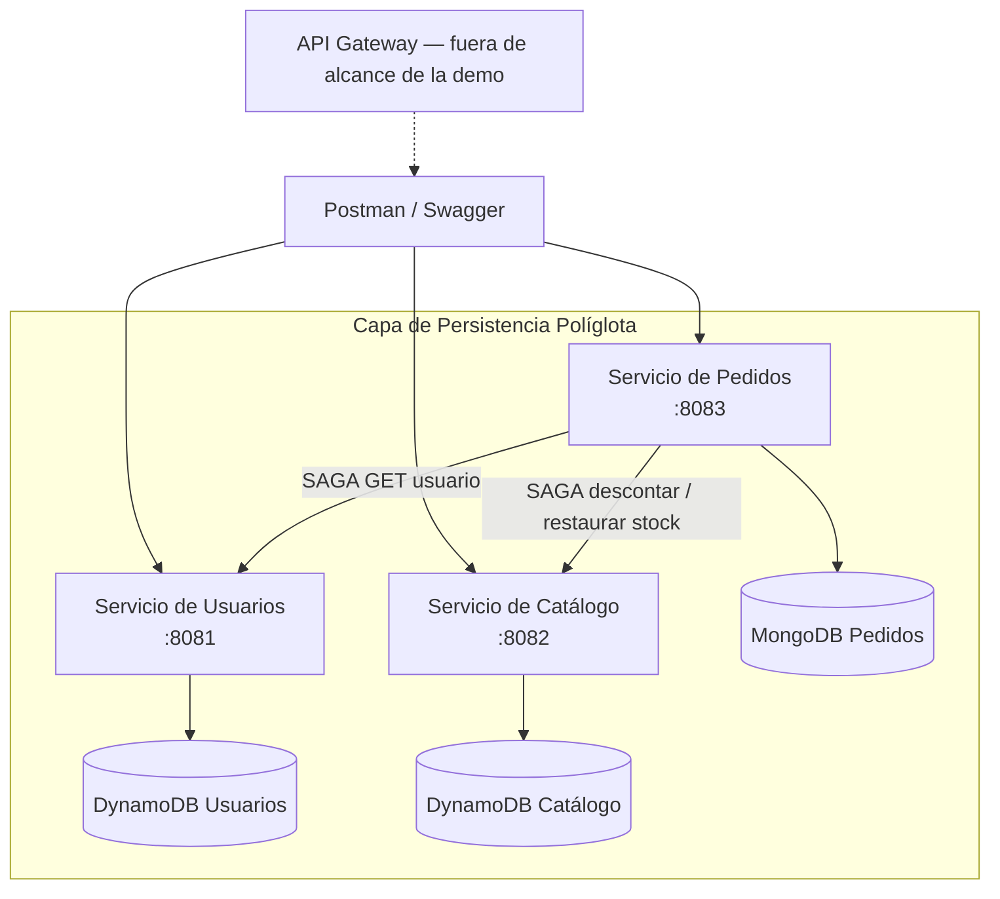
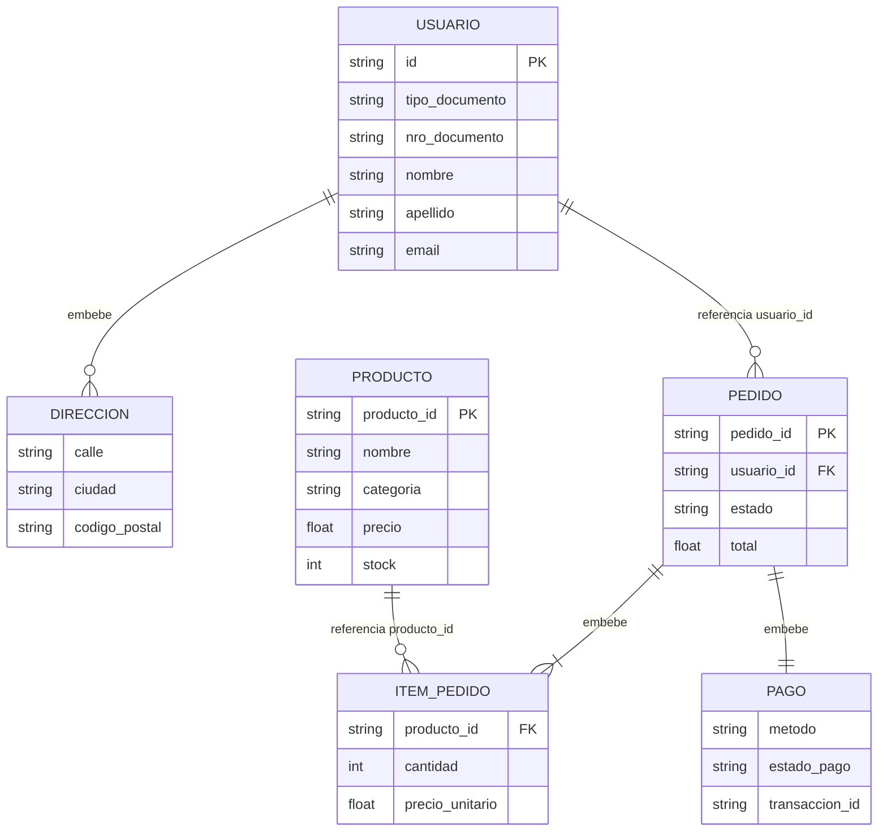
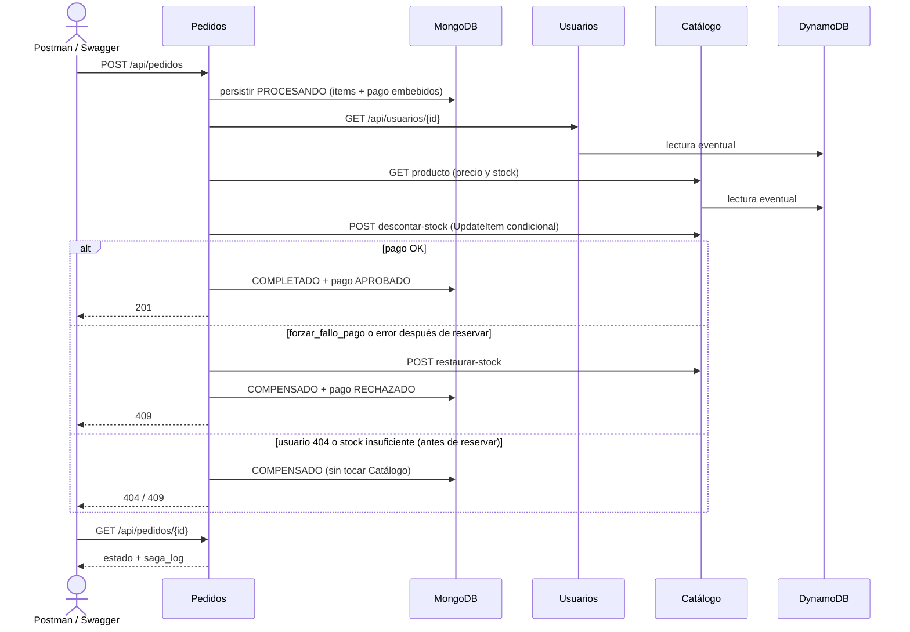
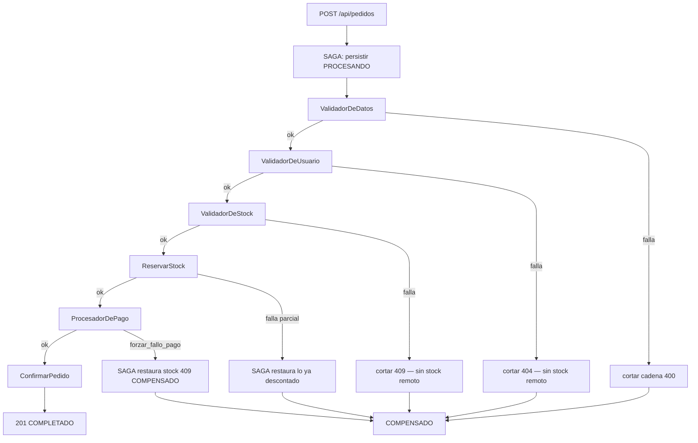

# ShopExpress - Arquitectura de Microservicios

## Justificación del diseño y arquitectura políglota

El diseño de la plataforma **ShopExpress** se fundamenta en una arquitectura de microservicios, donde cada dominio de negocio opera de forma autónoma y es dueño exclusivo de sus datos. Para satisfacer los requerimientos opuestos de rendimiento y consistencia planteados, se optó por un enfoque de persistencia políglota, desplegando el ecosistema sobre contenedores Docker e implementando la lógica en Spring Boot.

Las decisiones tecnológicas se detallan a continuación.

### 1. Servicio de Usuarios y Servicio de Catálogo e Inventario

- **Tecnología seleccionada:** Amazon DynamoDB (implementado vía dynamodb-local en Docker).
- **Justificación:** El requerimiento exige que la lectura de usuarios y del catálogo sea extremadamente rápida y escalable, priorizando explícitamente la disponibilidad y la tolerancia a particiones (sistemas AP) y aceptando la consistencia eventual. DynamoDB se alinea perfectamente con este escenario, ya que su modelo de lectura por defecto opera con consistencia eventual, ofreciendo un rendimiento predecible y una escalabilidad casi infinita. Adicionalmente, la elección resulta estratégica para los tiempos del proyecto: al haber investigado y expuesto sobre la historia, el diseño de esquemas y la ejecución de consultas con PartiQL de DynamoDB durante la Tarea 1, se cuenta con una base teórica sólida que asegura una implementación ágil y libre de una curva de aprendizaje pronunciada.
- **Modelado de datos:** Se aplica un patrón de referencia para cruzar dominios; el microservicio de catálogo gestiona los productos de forma independiente, y cualquier cruce de información con los usuarios se hace referenciando los identificadores únicos (IDs) a través de peticiones de red, manteniendo el desacoplamiento total.

### 2. Servicio de Pedidos y Pagos

- **Tecnología seleccionada:** MongoDB.
- **Justificación:** El procesamiento de pedidos requiere alta consistencia; un pedido debe ser único y se debe evitar a toda costa la sobreventa (vender sin stock). MongoDB proporciona consistencia fuerte a nivel de documento, garantizando que las escrituras del pedido sean seguras y atómicas. Además, al ser una base de datos documental que utiliza formato BSON (similar a JSON), absorbe de manera nativa la estructura jerárquica del pedido.
- **Modelado de datos:** Para este servicio, se optó por el patrón de datos embebido. Analizando la estructura de datos requerida, el documento del pedido contiene internamente un array de items (productos) y un sub-documento de pago con los datos de la transacción. Embeber esta información en un solo documento BSON en MongoDB optimiza la escritura atómica y evita consultas adicionales complejas al momento de asentar la orden.

### 3. Orquestación y aislamiento

Para cumplir con la regla de que ningún servicio acceda directamente a la base de datos de otro, el Servicio de Pedidos actúa como el orquestador central de la transacción. Al recibir un pedido, persiste la intención de compra en MongoDB con estado **PROCESANDO** y llama por **HTTP síncrono** a Usuarios (identidad) y Catálogo (descuento condicional de stock). Si un paso con efecto falla, restaura el stock y deja el pedido en **COMPENSADO**. Ver [Decisión: SAGA HTTP síncrona](#decisión-saga-de-orquestación-http-síncrona).

### Teorema CAP y persistencia políglota

ShopExpress se ubica en **CP** (MongoDB) y **AP** (DynamoDB), alineado con los requerimientos de consistencia de pedidos frente a disponibilidad de lecturas. Un mismo motor puede operar en más de un vértice según su configuración; aquí se usa la clasificación clásica.

| Tipo | Prioriza | Ejemplos típicos | ShopExpress |
|---|---|---|---|
| **CP** | Consistencia y tolerancia a particiones | Redis, MongoDB, HBase | **MongoDB** → Pedidos y pagos |
| **AP** | Disponibilidad y tolerancia a particiones | DynamoDB, Cassandra, CouchDB | **DynamoDB** → Usuarios y catálogo |
| **CA** | Consistencia y disponibilidad | Redshift, SQL Server, MySQL, Vertica, SAP HANA, Neo4j, PostgreSQL | No aplica (asume red estable) |

## Diagrama de Arquitectura


La demo pega a cada puerto. No hay API Gateway desplegado.

## Modelo Entidad Relacion

## Decisión: SAGA de orquestación HTTP síncrona

La letra pide **SAGA con orquestación** (Pedidos coordina pasos y compensaciones). No exige colas ni coreografía.

Un diseño inicial asíncrono (mensajería) se descartó para la demo: en 10 minutos hay que mostrar cada paso en Postman/Swagger y el `saga_log` del GET. Orquestación HTTP síncrona es el mismo patrón (un orquestador, pasos, compensación) y se puede seguir request a request.

| | Diseño inicial (README) | Implementación de la demo |
|---|---|---|
| Comunicación | Asíncrona | HTTP síncrono (`RestClient`) |
| Patrón | SAGA | SAGA de orquestación (igual) |
| Compensación | Restaurar stock | `POST .../restaurar-stock` si el corte es después de reservar |
| Cómo se muestra | Colas / consumers | Postman + `saga_log` + DynamoDB Admin / Compass |

## Diagrama de Flujo del Patrón SAGA


## Diagrama del Patrón Chain of Responsibility


**Cómo se separan en la defensa**

- **CoR** estructura la lógica *dentro* de Pedidos: cada handler procesa o corta; agregar uno no toca a los demás (`PedidoCadenaConfig`).
- **SAGA** es la transacción *entre* servicios: Pedidos persiste el pedido y, si el corte ocurre después de `ReservarStock`, llama a Catálogo para restaurar.

La cadena CoR es el camino feliz. La SAGA envuelve esa cadena con estado persistido y rollback distribuido.

## Comandos de Ejecución

Bases (DynamoDB Local in-memory, Mongo, DynamoDB Admin):

```bash
docker compose up -d
```

Microservicios:

```bash
docker compose -f docker-compose.app.yml up --build -d
./scripts/reset-demo.sh
```

`reset-demo.sh` vacía DynamoDB Local (in-memory), borra pedidos en Mongo, espera health y carga el seed (`usr_demo`, `prod_feliz` stock 5, `prod_comp` stock 2, `prod_agotado` stock 0). Solo recargar seed, sin borrar: `./scripts/seed-demo.sh`.

Health:

```bash
curl http://localhost:8081/api/health
curl http://localhost:8082/api/health
curl http://localhost:8083/api/health
```

| Qué | URL |
|---|---|
| Swagger Usuarios | http://localhost:8081/swagger-ui.html |
| Swagger Catálogo | http://localhost:8082/swagger-ui.html |
| Swagger Pedidos | http://localhost:8083/swagger-ui.html |
| DynamoDB Admin | http://localhost:8001 |
| Mongo Compass | `mongodb://localhost:27017` → db `pedidos` → colección `pedidos` |

DynamoDB Local está **in-memory**: si se reinicia `shopexpress-dynamo`, se pierden usuarios y productos; las apps recrean las tablas vacías.

## Testeo

Colección Postman en la raíz:

- `ShopExpress.postman_collection.json`
- `ShopExpress.postman_environment.json` (URLs `localhost:8081/8082/8083`)

Importar ambos en Postman, elegir el environment **ShopExpress localhost**, correr **00 Health**, **01 Feliz** y **02 Compensación** (Run folder). Esperado:

- Feliz: `POST /api/pedidos` **201**, `estado=COMPLETADO`, stock baja 1. El `saga_log` lista los 6 handlers.
- Compensación: **409**, `estado=COMPENSADO`, `saga_log` incluye restauración, stock igual que al inicio.

Carpeta **03 Cortes**: usuario `usr_no_existe` → **404**; `prod_agotado` cantidad 1 → **409**, sin descontar stock.

Ids del seed: `usr_demo`, `prod_feliz`, `prod_comp`, `prod_agotado`. Si `prod_feliz` llega a stock 0, `./scripts/reset-demo.sh`.
