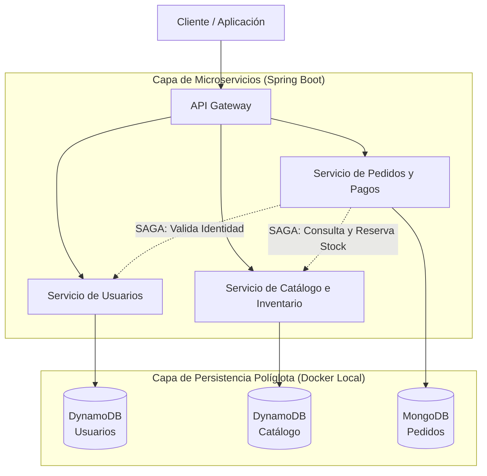
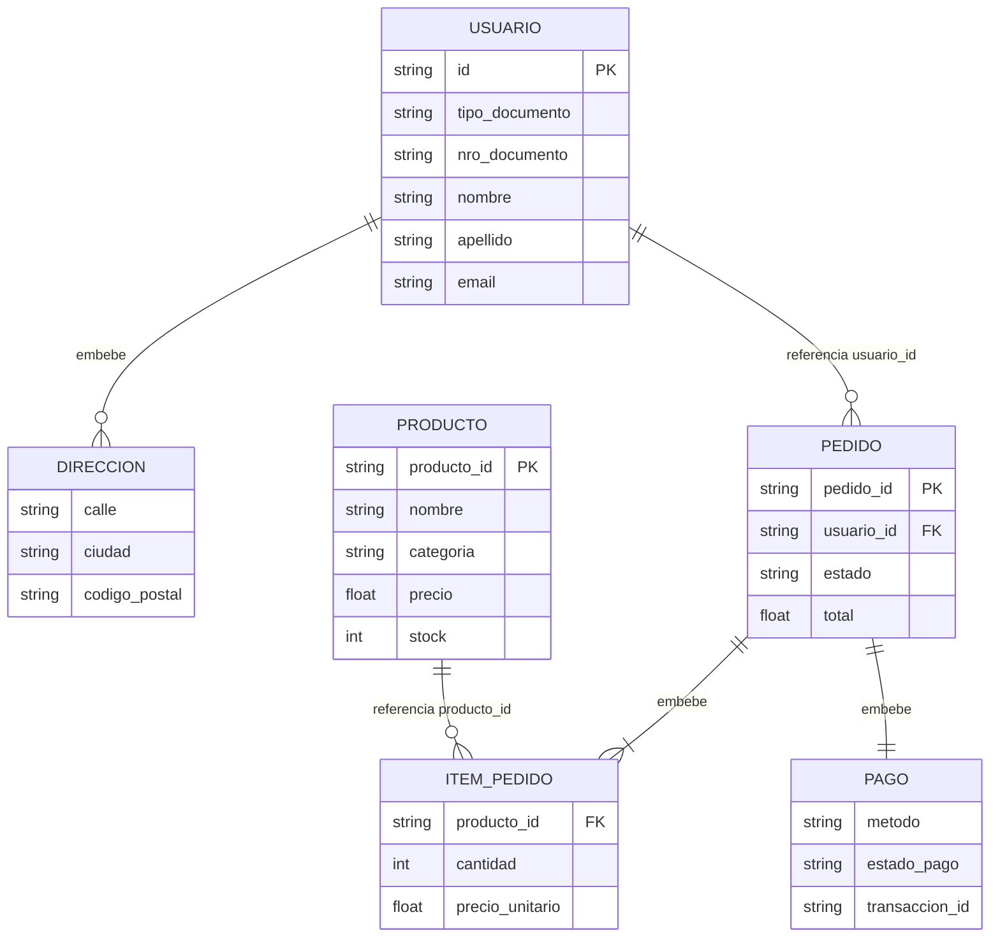

# ShopExpress - Arquitectura de Microservicios

## Justificación del diseño y arquitectura políglota

El diseño de la plataforma **ShopExpress** se fundamenta en una arquitectura de microservicios, donde cada dominio de negocio opera de forma autónoma y es dueño exclusivo de sus datos. Para satisfacer los requerimientos opuestos de rendimiento y consistencia planteados, se optó por un enfoque de persistencia políglota, desplegando el ecosistema sobre contenedores Docker e implementando la lógica en Spring Boot.

Las decisiones tecnológicas se detallan a continuación.

### 1. Servicio de Usuarios y Servicio de Catálogo e Inventario

- **Tecnología seleccionada:** Amazon DynamoDB (implementado vía dynamodb-local en Docker).
- **Justificación:** El requerimiento exige que la lectura de usuarios y del catálogo sea extremadamente rápida y escalable, priorizando explícitamente la disponibilidad y la tolerancia a particiones (sistemas AP) y aceptando la consistencia eventual. DynamoDB se alinea perfectamente con este escenario, ya que su modelo de lectura por defecto opera con consistencia eventual, ofreciendo un rendimiento predecible y una escalabilidad casi infinita. Adicionalmente, la elección resulta estratégica para los tiempos del proyecto: al haber investigado y expuesto sobre la historia, el diseño de esquemas y la ejecución de consultas con PartiQL de DynamoDB durante la Tarea 1, se cuenta con una base teórica sólida que asegura una implementación ágil y libre de una curva de aprendizaje pronunciada.
- **Modelado de datos:** Se aplica un patrón de referencia para cruzar dominios; el microservicio de catálogo gestiona los productos de forma independiente, y cualquier cruce de información con los usuarios se hace referenciando los identificadores únicos (IDs) a través de peticiones de red, manteniendo el desacoplamiento total.

### 2. Servicio de Pedidos y Pagos

- **Tecnología seleccionada:** MongoDB.
- **Justificación:** El procesamiento de pedidos requiere alta consistencia; un pedido debe ser único y se debe evitar a toda costa la sobreventa (vender sin stock). MongoDB proporciona consistencia fuerte a nivel de documento, garantizando que las escrituras del pedido sean seguras y atómicas. Además, al ser una base de datos documental que utiliza formato BSON (similar a JSON), absorbe de manera nativa la estructura jerárquica del pedido.
- **Modelado de datos:** Para este servicio, se optó por el patrón de datos embebido. Analizando la estructura de datos requerida, el documento del pedido contiene internamente un array de items (productos) y un sub-documento de pago con los datos de la transacción. Embeber esta información en un solo documento BSON en MongoDB optimiza la escritura atómica y evita consultas adicionales complejas al momento de asentar la orden.

### 3. Orquestación y aislamiento

Para cumplir con la regla de que ningún servicio acceda directamente a la base de datos de otro, el Servicio de Pedidos actúa como el orquestador central de la transacción. Al recibir un pedido, este servicio persistirá la intención de compra en MongoDB con estado **PROCESANDO** y se comunicará de forma asíncrona con los servicios de Usuarios y Catálogo (DynamoDB) para validar la identidad y descontar el stock, garantizando la integridad sin sacrificar la autonomía de cada componente.

## Diagrama de Arquitectura

## Modelo Entidad Relacion

## Diagrama de Flujo del Patrón SAGA
*(Pendiente de generar)*

## Diagrama del Patrón Chain of Responsibility
*(Pendiente de generar)*

## Comandos de Ejecución
1. Levantar bases de datos: `docker compose up -d`
2. Construir microservicios: *(Ej. `mvn clean install`)*
3. Levantar contenedores de aplicaciones: `docker compose -f docker-compose.app.yml up --build`

## Testeo
Se adjunta la colección de Postman `ShopExpress.postman_collection.json` en la raíz del proyecto para evidenciar el testeo de los endpoints requeridos.
